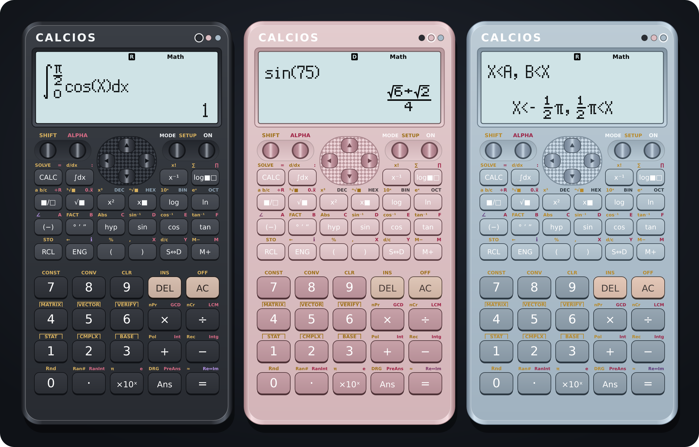
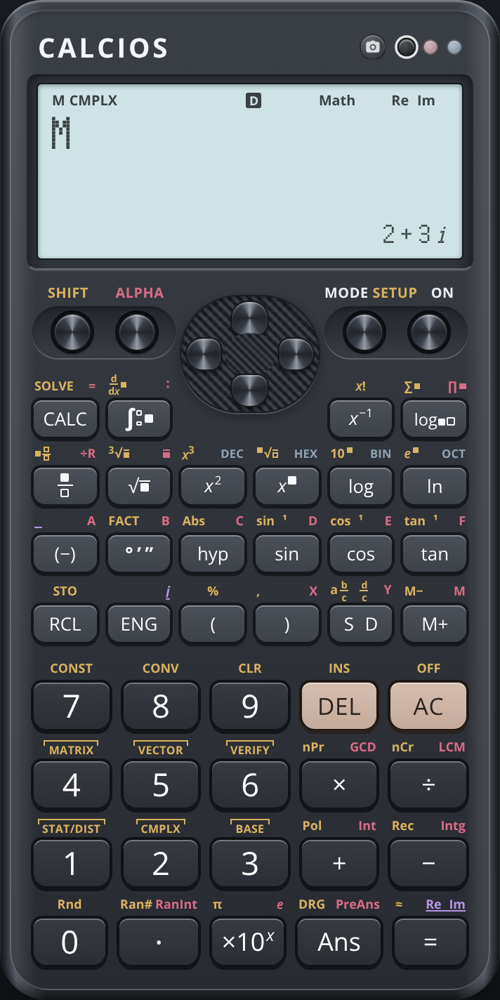
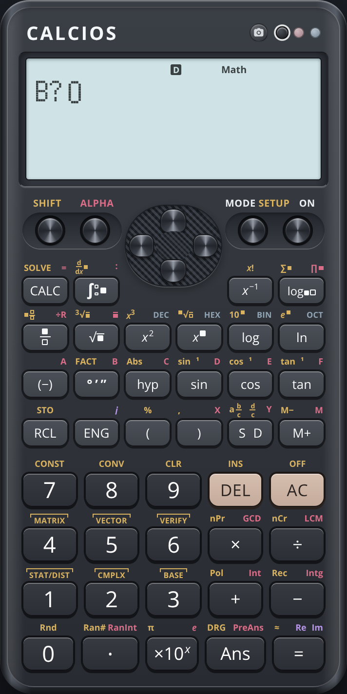
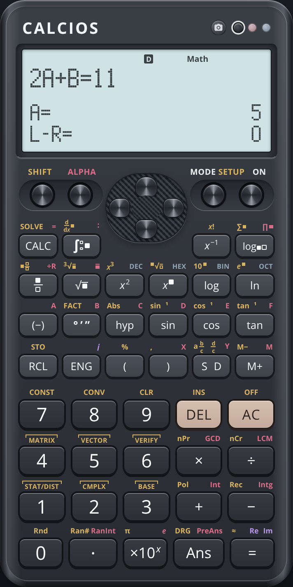
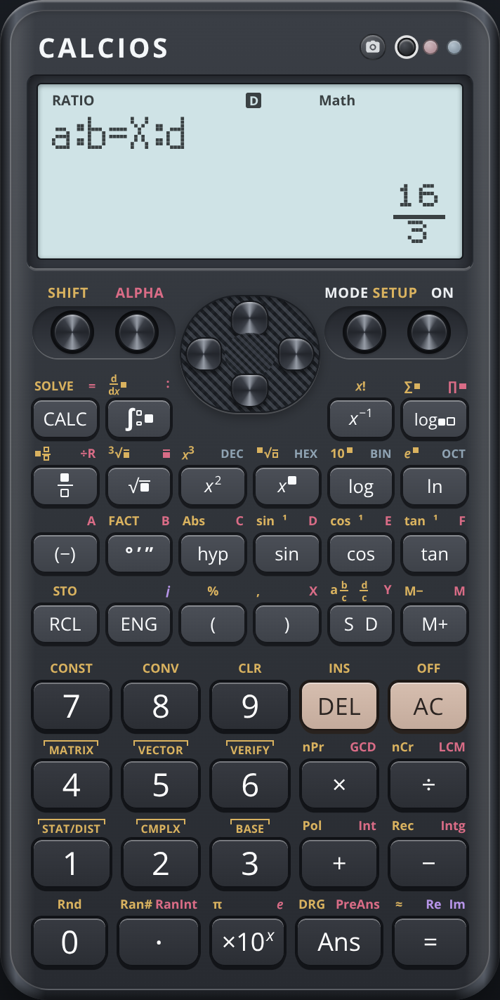
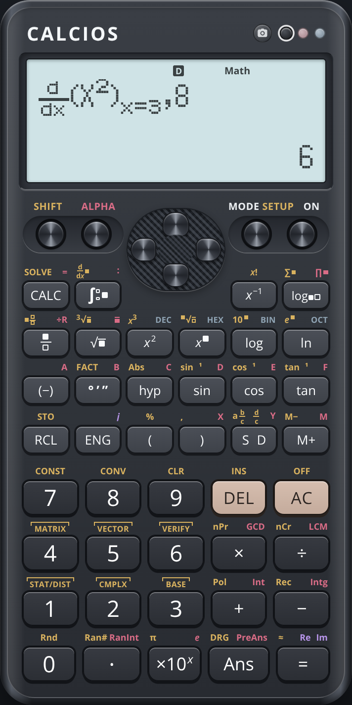
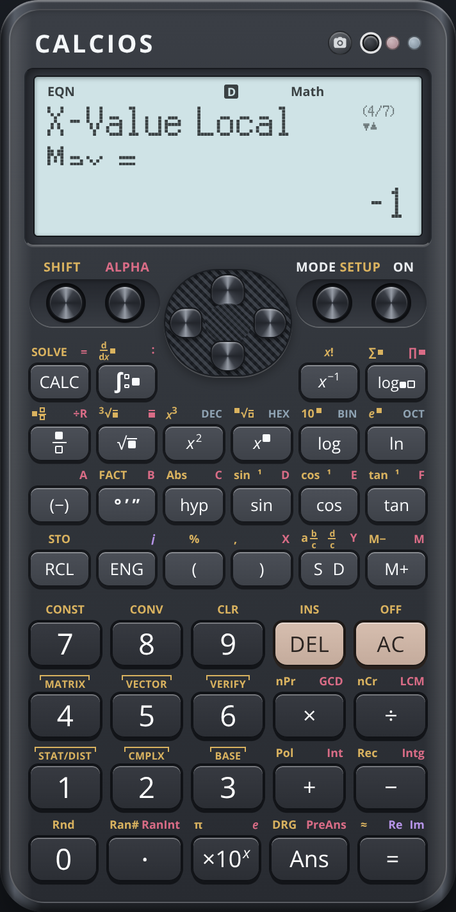
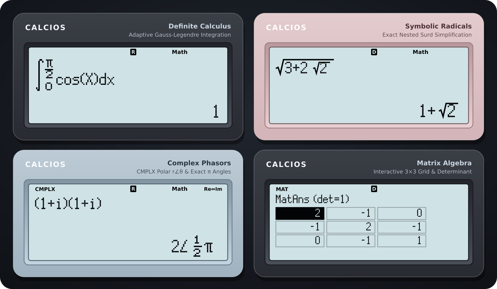
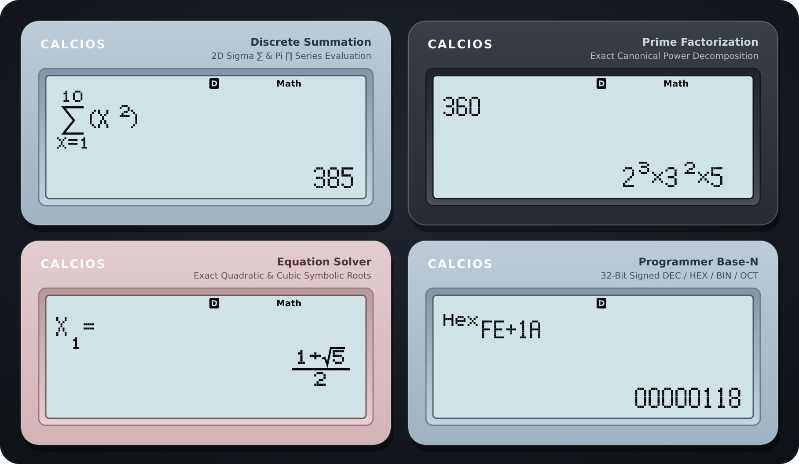

<div align="center">

# CALCIOS

**A precise, handheld-style scientific calculator with 2D Natural Math**

[](#tech-stack)
[](#tech-stack)
[](#quick-start)
[](#quality--verification)

A realistic, handheld-scale calculator featuring an exact symbolic engine, custom dot-matrix LCD, an interactive natural-math renderer, and **12 operating modes**. Its established casing, key layout, and calculator workflows are retained as new math capabilities are added.

[Open the live calculator](https://revolover00.github.io/calcios/)

<br />



</div>

---

## Screenshots: New Features

These captures show the new calculator screens in the existing hardware and LCD design.

<p align="center">
  
  
  
</p>

<p align="center">
  
  
  
</p>

---

## Mathematical Calculations Showcase

Calcios combines exact symbolic arithmetic (`BigInt` rationals, surds, and $\pi$ multiples) with high-precision numerical solvers. Results appear on a crisp FSTN-style LCD with `MathIO` and `LineIO` input/output modes.

<p align="center">
  
</p>

<p align="center">
  
</p>

---

## Highlights

- **Natural Math LCD** — multi-level fractions, radicals, powers, logarithms, integrals, derivatives, summations, and products, with structural cursor navigation.
- **Exact symbolic engine** — rational and mixed fractions, surds (including nested roots), exact trigonometric values, $\pi$ multiples, recurring decimals, and decimal/exact conversion.
- **Complex variable memory and trigonometry** — `A`–`F`, `M`, `X`, and `Y` retain both real and imaginary components in `CMPLX`; `STO`, `RCL`, `M+`, and `M−` operate on complex values. Circular and inverse trigonometric functions follow the selected `DEG`/`RAD`/`GRA` setting; inverse hyperbolic functions accept complex arguments. A real-mode write replaces a variable with a real value.
- **Expanded SOLVE workflow** — solve for a chosen variable with the optional trailing target form `equation, A`. Other variables in the equation are requested before solving; a lone non-`X` variable can be inferred as the target.
- **Calculus tolerances** — `d/dx(f(X), a, tol)` and `∫(f(X), a, b, tol)` accept an optional tolerance. Integer `tol` values from `1` through `14` mean `10⁻ᵗᵒˡ`; an explicit tolerance may be any value strictly between `0` and `1`.
- **Installable offline PWA** — calculator state and preferences persist between visits, and the app shell can be used offline after it has been cached.
- **Three hardware editions** — switch between **Onyx Black**, **Dusty Rose Pink**, and **Ice Steel Blue** from the color dots on the bezel.
- **Built-in reference tools** — 40 CODATA physical constants and 40 unit conversions.
- **Camera/image math scanner** — use the camera control or paste an image to scan a math problem into the calculator.

---

## 12 Operating Modes

Press **MODE** to open the first page; press **▼** to reach the second page.

| Menu | Mode | Capabilities |
| :-: | :--- | :--- |
| `1` | **COMP** | General calculations, variable substitution, `CALC`/`SOLVE`, calculus, summations/products, factorization, `Pol`, `Rec`, DMS, and real-valued operations. |
| `2` | **CMPLX** | Rectangular and polar complex arithmetic, complex variable memory, `STO`/`RCL`, and complex `M+`/`M−`. |
| `3` | **STAT** | One- and two-variable data editors, summary statistics, and regression models. |
| `4` | **BASE-N** | Signed 32-bit `DEC`, `HEX`, `BIN`, and `OCT` arithmetic with bitwise operations. |
| `5` | **EQN** | Two- and three-variable linear systems, quadratic and cubic roots; cubic equations also show local extrema when present. |
| `6` | **MATRIX** | Matrix editor and matrix arithmetic, determinant, transpose, and inverse. |
| `7` | **TABLE** | Function tables for $f(X)$ and optional $g(X)$ over a chosen range. |
| `8` | **VECTOR** | 2D and 3D vector arithmetic, dot products, and cross products. |
| `▼` → `1` | **INEQ** | Quadratic and cubic inequalities using `<`, `>`, `≤`, and `≥`. |
| `▼` → `2` | **VERIF** | Mathematical equality and inequality checks. |
| `▼` → `3` | **DIST** | Normal, binomial, and Poisson probability distributions. |
| `▼` → `4` | **RATIO** | Solve either `a:b = X:d` or `a:b = c:X`, with exact/decimal display and variable storage. |

### SOLVE and Calculus Examples

- For an equation such as `2A+B=11,A`, SOLVE asks for `B`, then finds `A` and reports the `L−R` residual.
- With no explicit target, a single-variable equation such as `2Y+3=11` solves for `Y`.
- Optional tolerance syntax: `deriv(X^2,3,8)` and `integ(X,0,1,8)`.

---

## Keyboard Shortcuts

Hardware keys can be clicked or used from a physical keyboard.

| Keyboard | Action |
| :--- | :--- |
| `0`–`9`, `.` | Digits and decimal point |
| `+`, `-`, `*`, `/` | Arithmetic operations |
| `(`, `)`, `,` | Parentheses and argument separator |
| `^` | Power template |
| `Enter` / `=` | Evaluate |
| `Backspace` | Delete |
| `Escape` | All Clear |
| Arrow keys | D-pad navigation, cursor movement, and history navigation |
| `s` / `a` / `m` | `SHIFT` / `ALPHA` / `MODE` |
| `d` | Exact/decimal toggle (`S⇔D`) |
| `x` / `y` | Insert variable `X` / `Y` |
| `p` | Insert $\pi$ |
| `r` | Insert square root |
| `f` | Insert a 2D fraction |
| `i` | Insert the imaginary unit in `CMPLX` |
| `c` / `t` / `l` / `n` | Insert cosine / tangent / logarithm / natural logarithm |

---

## Quick Start

```bash
# Install dependencies
npm ci

# Optional: configure server-only Groq credentials for local scanning
cp .env.example .env.local
# Edit .env.local and set GROQ_API_KEY_1 (never use a VITE_ prefix)

# Start the Vite development server
npm run dev

# Build the production app
npm run build
```

## Quality & Verification

```bash
# TypeScript project check
npm run typecheck

# Full Vitest suite
npm test
```

The suite covers the calculator engine, parser, LCD interactions, mode workflows, persistence, and regression tests.

---

## Deploying to GitHub Pages

The repository includes a GitHub Actions Pages workflow (`.github/workflows/deploy.yml`) configured with a relative Vite base path. GitHub Pages is static hosting, so the calculator works there but image scanning requires a server API and is unavailable on Pages alone.

1. In **Settings → Pages**, set the source to **GitHub Actions**.
2. Push to `main` or trigger the Pages deployment workflow from **Actions**.
3. For image scanning, deploy on Vercel and configure `GROQ_API_KEY_1` (and optional `GROQ_API_KEY_2`…`GROQ_API_KEY_5`) as server-side environment variables. Do not add a `VITE_` prefix or put keys in GitHub Pages build secrets.

---

## Project Structure

```text
calcios/
├── docs/
│   ├── HANDOFF.md
│   └── screenshots/               # Existing showcase images and new feature captures
├── public/                        # PWA manifest, icons, and service worker assets
├── scripts/                       # LCD font-generation script
├── src/
│   ├── assets/                    # Custom dot-matrix LCD fonts
│   ├── components/
│   │   ├── CalculatorHardware.tsx # Chassis, key layout, themes, and camera control
│   │   ├── LcdScreen.tsx          # LCD, menus, editors, and prompts
│   │   └── NaturalMath.tsx        # 2D math renderer
│   ├── core/
│   │   ├── calculator.ts         # Reducer, modes, and session persistence
│   │   ├── expression.ts         # Tokenizer, parser, and evaluator
│   │   ├── value.ts              # Decimal, exact rational, and stored scalar values
│   │   ├── calculus.ts            # Derivative, integration, and numerical solvers
│   │   ├── cmplx.ts               # Complex arithmetic and evaluation
│   │   ├── eqn.ts / ineq.ts       # Equation and inequality solvers
│   │   ├── ratio.ts               # Proportion solver
│   │   ├── matrix.ts / vector.ts  # Linear algebra engines
│   │   ├── stat.ts / dist.ts      # Statistics and distributions
│   │   └── constants.ts           # Scientific constants and unit conversions
│   ├── data/keyLayout.ts          # Key definitions and legends
│   └── styles/calculator.css      # Existing hardware and LCD styles
└── package.json
```
